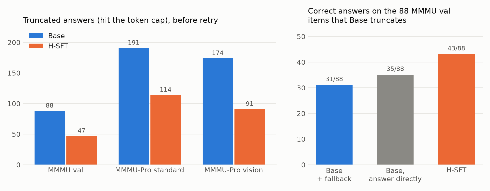

# H-SFT: training Qwen3-VL-4B-Instruct on its own correct solutions (MMMU)

Team 1 (1팀), Multimodal Deep Learning, Fall 2026: 김규린, 김재형, 박건우, 서정우

We fine-tune **Qwen3-VL-4B-Instruct** for MMMU / MMMU-Pro. The final model, **H-SFT**, is a LoRA on the language
model's attention only, trained on 637 solutions that the base model itself wrote and got right. The vision encoder and
the connector are frozen. Everything (evaluation, retry, training, merging, MMMU test submission file) runs through one
script, [`run.sh`](run.sh).

## Results

All scores are "Pipeline" accuracy (explained under [Evaluation](#evaluation)). Base and H-SFT always use the same
evaluation recipe (`best_r2u`). Per-item files for every number with a path are in [`MMD/results/`](MMD/results).

### MMMU val (900 items)

| | Base | H-SFT | Qwen model card |
|---|---|---|---|
| Single run, seed 3407 | 65.56 (88 truncated) | **66.22** (47 truncated) | |
| + retry of truncated answers | 66.67 | **66.44** (13 truncated) | 67.4 |
| Reproduction run, 2026-11-22 (same adapter, fresh Colab) | | 66.89 (45 truncated) → **67.00** with retry | |

The reproduction run used only this repository on an empty Colab A100. Its per-item files are not in the repository;
the first run's are (`MMD/results/h_sft_s3407`, `MMD/results/h_sft_retry`). The difference between the two runs (about
0.5 percentage points) is vLLM run-to-run variation: the base model alone moved between 64.22% and 65.78% when only the
seed changed.

### MMMU-Pro (1,730 items each, truncated answers retried on both sides)

| | Base | H-SFT |
|---|---|---|
| Standard, 10 options ([base](MMD/results/pro10_base_retry_c32), [H-SFT](MMD/results/pro10_h_sft_retry_c32)) | 55.61 | **56.71** |
| Vision ¹ | 52.54 | **53.58** |
| Mean | 54.08 | **55.14** (+1.06) |
| Qwen model card (MMMU-Pro full) | 53.2 | |

¹ The per-item files of the vision retry are not in the repository. Before retry: [base](MMD/results/prov_base_s3407)
51.33, [H-SFT](MMD/results/prov_h_sft_s3407) 52.95.

### MMMU test (10,500 items, H-SFT, no retry)

**63.63** (Strict 61.48, 677 truncated). By discipline: Business 75.98, Humanities & Social Science 73.81, Health &
Medicine 65.01, Art & Design 61.05, Science 61.01, Tech & Engineering 56.32. Scored locally with the answers included in
the Hugging Face `MMMU/MMMU` test split; the base model was not run on test, and the output files are not in the
repository. `bash run.sh submission NAME` also writes the answer file for the official MMMU evaluation server.

### What H-SFT changes

- **Truncation, not accuracy.** On MMMU val the accuracy difference is within run-to-run noise (McNemar p = 0.67), but
  truncated answers drop in all three evaluations (88 → 47, 191 → 114, 174 → 91; p < 0.001 each). On the 793 items
  that both models finish, accuracy is the same (68.7 vs 68.9). H-SFT gains by finishing its reasoning.
- **Engineering subjects** rise from 47.3% to 53.0% over the three evaluations (p = 0.008); Tech & Engineering is still
  the weakest discipline on MMMU test.



### Truncation analysis: why not just ask for the answer first?

Truncation is the main error H-SFT fixes, so a natural question is whether a prompt that asks for the answer first
would avoid it. It does not pay off. Item-by-item on MMMU val, same 900 questions
([`MMD/scripts/truncation_analysis.py`](MMD/scripts/truncation_analysis.py) recomputes every number here and draws the
figure):

- **Answering first costs more than truncation does.** The Assignment 1 run that asked for the answer directly
  ([`MMD/results/raw_baseline`](MMD/results/raw_baseline)) scored 59.56, against 65.22 for the chain-of-thought recipe
  (63.3 vs 56.7 in a 90-item A/B at the same seed and token budget, see
  [baseline/docs/best_run.md](baseline/docs/best_run.md)).
  The model generates left to right, so an answer written first cannot use any of the reasoning that follows it.
- **On the 88 items Base truncates,** Base with the fallback pass gets 31 right and the answer-first run 35 (p = 0.60).
  Swapping in the answer-first answers for Base's truncated items gives +4 items (66.00%), less than simply retrying
  them (+10, 66.67%). On H-SFT the same swap loses 4 items: of its 47 truncated items, 20 also truncate when asked to
  answer directly, and there the answer-first run gets 2 right against 10 for H-SFT's fallback.
- **H-SFT gets 43 of those 88 right** (Base 31; H-SFT only 24, Base only 12; p = 0.065), mostly by finishing 60 of
  them. The cost is 19 items that H-SFT newly truncates: Base got 14 of them right, H-SFT 7 (p = 0.039). Net, +6 items
  (590 → 596).

The answer-first run differs in more than the prompt (seed 42, images ≤ 1,003,520 pixels, 8,192-token cap), so these
numbers compare two settings, not a prompt-only ablation.

### Other runs (MMMU val, same recipe)

| Run | Training | Pipeline | Truncated |
|---|---|---|---|
| [H-DPO](MMD/results/h_dpo_s3407) | DPO (β 0.1) on 672 correct / wrong pairs from the same data | 65.33 | 107 |
| [H-DPO, larger pairs](MMD/results/h_dpot_s3407) | DPO on 1,116 pairs | 64.56 | 104 |
| [T-SFT](MMD/results/t_sft_s3407) | SFT on 2,153 solutions of Qwen3-VL-32B (teacher) | 62.78 | 14 |
| [Base, no image](MMD/results/base_noimg_s3407) | – | 46.22 | 26 |
| [H-SFT, no image](MMD/results/h_sft_noimg_s3407) | – | 48.89 | 13 |

The full history (evaluation setup, a pilot on engineering diagrams, connector training, team tracks, teacher
distillation) is in [docs/EXPERIMENTS.md](docs/EXPERIMENTS.md) (Korean).

## Method

1. **Questions:** 3,000 [ViRL39K](https://huggingface.co/datasets/TIGER-Lab/ViRL39K) questions with one image and a
   rule-checkable answer (one option letter or one number). MMMU val images were removed by hash. No MMMU or MMMU-Pro
   data is used for training.
2. **Solutions:** the base model writes 8 solutions per question with the evaluation sampling (T 0.7, top_p 0.8,
   top_k 20, presence penalty 1.5), images 1.0–2.0 M pixels.
3. **Checking (rules, no LLM judge):** a solution counts only if it finished and ends with a parsable `Answer:` line.
   Multiple choice: the letter must match. Numbers: relative error at most 0.1%. 17,875 of 24,000 solutions were valid,
   86.7% of them correct.
4. **Selection:** keep questions the base model solves 25–85% of the time with at least 6 valid solutions (245
   questions); drop solutions over 1,500 tokens. SFT uses the correct ones, shortest first (637 examples).
5. **Training:** LoRA r16 / α32 on attention q·k·v·o of the language model (11.8 M parameters), lr 5e-5, 1 epoch
   (80 optimizer steps), gradient accumulation 8, seed 3407, about 40 minutes on one A100 40 GB.

## Evaluation

The evaluator is [`MMD/`](MMD) (vLLM 0.29). Recipe `best_r2u`, used for every number above: Qwen/VLMEvalKit MMMU prompt
with the image first, Qwen's chain-of-thought sentence and a final `Answer: X` line; images fixed at 4,014,080 pixels;
up to 32,768 new tokens; seed 3407 with a per-item seed.

- **Strict:** the official MMMU answer parser ([`MMD/scripts/mmmu_official_eval_utils.py`](MMD/scripts/mmmu_official_eval_utils.py),
  pinned by SHA-256), except that a parse failure counts as wrong instead of a random guess.
- **Pipeline:** Strict, preceded by two deterministic steps. (1) If an answer was truncated, or a multiple-choice answer
  contains no option letter, a greedy second pass continues it with `Therefore, the final answer is (` for at most 16
  tokens, and its first letter is the answer. (2) Otherwise the last `Answer: X` line, then the last `\boxed{X}`, is
  taken before the official parser.
- **Retry:** answers that still hit the 32,768-token cap are regenerated with seed 1001, then 1002; a finished retry
  replaces the original.

Base vs H-SFT comparisons use exact McNemar tests on the same items.

## Reproduce

Requirements: one NVIDIA GPU (A100 40 GB or larger), Linux, Python 3.10+, about 60 GB of disk, and access to Hugging Face
(model `Qwen/Qwen3-VL-4B-Instruct` at revision `ebb281ec`, datasets `MMMU/MMMU`, `MMMU/MMMU_Pro`, `TIGER-Lab/ViRL39K`).
Google Colab with an A100 runtime works: clone the repository and run the same commands in a terminal cell.

```bash
bash run.sh setup        # vLLM 0.29, PEFT
bash run.sh check        # GPU, data files, a one-item-per-subject smoke run
bash run.sh reproduce    # merge release/H-sft-lora -> MMMU val (900) -> retry on truncation
```

Expect about ±1 percentage point from the values above: vLLM sampling differs slightly between GPU types.

| Command | What it does | Time on one A100 |
|---|---|---|
| `bash run.sh merge [LORA] [OUT]` | LoRA + base → full checkpoint (default `release/H-sft-lora` → `work/merged/H-sft`) | 2 min |
| `bash run.sh eval NAME MODEL [DATASET]` | Generate and score. `MODEL` = `base` or a checkpoint folder. `DATASET` = `val`, `pro10` (MMMU-Pro standard), `pro_vision`, `test` | val 1–2 h, Pro 3–4 h, test about 25 h |
| `bash run.sh retry NAME MODEL [DATASET]` | Regenerate truncated answers of `NAME` (seeds 1001, 1002) → `NAME_retry` | 30–60 min |
| `bash run.sh submission NAME` | `MMD/results/NAME/scored.jsonl` → `MMD/submissions/NAME.json` for the MMMU test server | seconds |
| `bash run.sh build` | `data/gen.jsonl` → `data/build2` (training data; recreates it exactly) | seconds, CPU |
| `bash run.sh virl` | Download ViRL39K images to `data/virl` (needed by `train` and `generate`) | 10–20 min |
| `bash run.sh train [sft\|dpo]` | `data/build2` → `work/runs/H-sft/lora` | 40 min |
| `bash run.sh generate` | From scratch: pick ViRL39K questions, sample 8 solutions each, build the training data | 5–8 h |

Evaluations resume from `MMD/outputs/NAME.jsonl` if interrupted; scores land in `MMD/results/NAME/` (`summary.json`,
`results.md`, `scored.jsonl`, `by_subject.csv`). Examples:

```bash
bash run.sh eval base_val base val                          # base model, MMMU val
bash run.sh eval pro10_h_sft work/merged/H-sft pro10        # H-SFT, MMMU-Pro standard
bash run.sh eval test_h_sft work/merged/H-sft test          # MMMU test
bash run.sh submission test_h_sft

# train your own adapter instead of using the released one
bash run.sh virl
bash run.sh train sft
bash run.sh merge work/runs/H-sft/lora work/merged/H-sft-mine
bash run.sh eval h_sft_mine work/merged/H-sft-mine val
```

## Repository layout

| Path | Content |
|---|---|
| [`run.sh`](run.sh) | The single entry point |
| [`release/H-sft-lora/`](release/H-sft-lora) | The adapter behind every H-SFT number (47 MB) and its `training_run.json` |
| [`data/`](data) | `items.jsonl` (3,267 ViRL39K questions), `gen.jsonl` (24,000 base-model solutions), `build2/` (637 SFT examples, 672 DPO pairs, 63 validation pairs) |
| [`H/`](H) | The pipeline in order: `step01` pick questions … `step05` train, `step06` merge, `step07`–`step10` evaluator patches (no-image, MMMU-Pro, MMMU test, chunked writing), `step11` retry, `step12` submission file. `step13`–`step16`: side experiments (teacher solutions, synthetic questions) |
| [`MMD/`](MMD) | MMMU evaluator (vLLM), run outputs and scores, and `scripts/truncation_analysis.py`. Also the connector-training code of an earlier phase (`src/train_merger.py`, `spatial_merger.py`, `residual_merger.py`) |
| [`docs/figures/`](docs/figures) | Figures in this README (`truncation_analysis.py --plot` redraws them) |
| [`colab/`](colab) | The Colab and lab-server scripts the results were produced with, kept as a record (they assume `/content` paths) |
| [`docs/EXPERIMENTS.md`](docs/EXPERIMENTS.md) | Every experiment, why it was run and what it gave (Korean) |
| [`baseline/`](baseline) | Assignment 1 as submitted (2026-09-26): baseline evaluation report [`baseline/reports/mmmu_baseline.md`](baseline/reports/mmmu_baseline.md), the evaluator at that time, and its outputs |

## Notes

- Image paths inside `data/*.jsonl` were written on Colab (`/content/virl/...`); the scripts map them to `$VIRL_DIR`.
- The MMMU-Pro vision numbers used a 16,384-token cap; the standard numbers use 32,768 for the items still truncated at
  16,384.
- Code from elsewhere: `MMD/scripts/mmmu_official_eval_utils.py` is the answer parser of the official
  [MMMU repository](https://github.com/MMMU-Benchmark/MMMU); the prompt text follows Qwen3-VL's
  `evaluation/mmmu/run_mmmu.py`.
